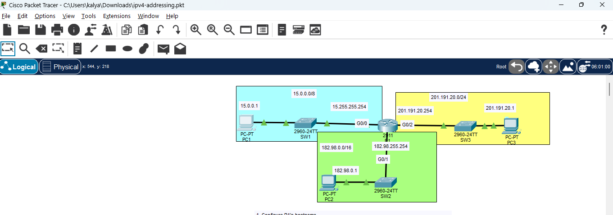

# Lab 01: IPv4 Addressing and Basic Connectivity

## Objective
Configure IPv4 addresses and subnet masks on PCs
and verify connectivity across multiple networks
using a router in Cisco Packet Tracer.

## Tools Used
- Cisco Packet Tracer
- Cisco IOS CLI

## Network Topology

## IP Addressing Table

| Device | IP Address | Subnet Mask |
|---|---|---|
| PC1 | 15.0.0.1 | 255.0.0.0 |
| PC2 | 182.98.0.1 | 255.255.0.0 |
| PC3 | 201.191.20.1 | 255.255.255.0 |

## Tasks Performed
- Configured IPv4 addresses on end devices.
- Connected three separate networks through a router.
- Tested connectivity using ping.
- Verified communication between devices.

## Verification Results
- PC1 to PC3: [Success]
- PC1 to PC2: [Success]

## Key Learnings
- IPv4 addresses and subnet masks.
- Identifying different IP networks.
- The role of a router in forwarding traffic between networks.
- Verifying connectivity using ICMP ping.

## Project File
Download `ipv4-addressing.pkt` to explore the lab in
Cisco Packet Tracer.
